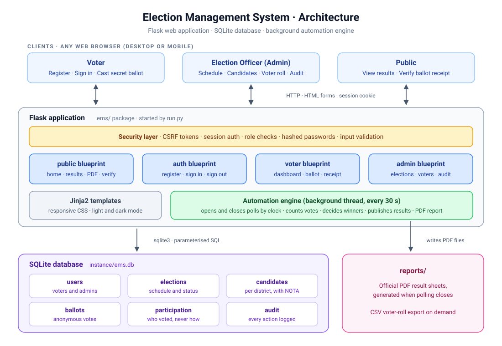

<div align="center">

# 🗳️ Election Management System

**A fully automated election platform: voter registration, secret ballot voting, live turnout and results that publish themselves.**


</div>

---

## The story behind this project

This was my **first professional project**.

I built the Election Management System as my **Class 12 final project**, working on it for **eight months, across the whole school year**. At the time, I knew only **Python and MySQL**. With just those two, I designed and built a working election system covering voter registration, voting, result counting and printable PDF result sheets.

Both my **internal and external examiners were highly satisfied** with the project, and with it I secured **100/100** in my final examinations.

The original Class 12 version (Python, Tkinter and MySQL) is preserved in [`legacy/`](legacy/). The rest of this repository is **version 2**: a complete redesign of the same idea as a secure, fully automated web application.

---

## Highlights

| | |
|---|---|
| ⚙️ **Fully automated** | Elections open and close on schedule. When polling ends, votes are counted, winners are decided, results are published and an official PDF report is generated, all without anyone pressing a button. |
| 🪪 **Instant voter onboarding** | Eligibility checks (age 18+, valid Aadhaar and phone, no duplicates) run at registration. A unique Voter ID is issued immediately. |
| 🤫 **Secret ballot** | Votes are stored with **no link to the voter**. A separate record only tracks *that* someone voted, so nobody can vote twice. |
| 🧾 **Verifiable** | Every voter gets a receipt code to confirm their ballot was counted, without revealing their choice. |
| 📊 **Live dashboards** | District-wise turnout, party vote totals, seats won and per-district winners with tie detection. |
| 🛡️ **Secure by design** | Hashed passwords, CSRF protection, role-based access, parameterised SQL and a full audit log. |
| 📱 **Works anywhere** | Responsive interface for phone, tablet and desktop, with automatic dark mode. |

## Architecture

<p align="center"></p>

The full write-up of the architecture, database design and workflows is in **[docs/DOCUMENTATION.md](docs/DOCUMENTATION.md)**.

## Quick start

```bash
git clone https://github.com/PriyamMishra853/Election-Management-System--Priyam-Mishra.git
cd Election-Management-System--Priyam-Mishra
python3 -m venv .venv
source .venv/bin/activate        # Windows: .venv\Scripts\activate
pip install -r requirements.txt
python run.py
```

Open **http://127.0.0.1:5000**. The first run creates the database, an admin account and a live demo election.

| Role | Login | Password |
|---|---|---|
| Admin (Election Officer) | `ADMIN001` | `admin123` |
| Demo voters (3) | Voter IDs are listed under **Admin → Voters** | `voter123` |

Step-by-step instructions for Windows, macOS and Linux, configuration options and troubleshooting are in **[docs/SETUP.md](docs/SETUP.md)**.

## Project structure

```text
Election-Management-System/
├── run.py                    # Entry point: python run.py
├── requirements.txt          # Runtime dependencies (Flask, ReportLab)
├── requirements-dev.txt      # + pytest for running the tests
├── pyproject.toml            # Project metadata and test settings
│
├── ems/                      # The application package
│   ├── __init__.py           # App factory: wires everything together
│   ├── config.py             # Settings (all overridable by environment variables)
│   ├── db.py                 # Database schema, connections, audit log, first-run seeding
│   ├── automation.py         # Automation engine: scheduler, vote counting, PDF reports
│   ├── security.py           # Login checks, roles, CSRF protection, input validation
│   ├── utils.py              # Districts, date helpers, election status
│   ├── routes/
│   │   ├── public.py         # Home, results, PDF download, receipt verification
│   │   ├── auth.py           # Registration, sign in, sign out
│   │   ├── voter.py          # Voter dashboard and secret ballot
│   │   └── admin.py          # Elections, candidates, voter roll, audit log
│   ├── templates/
│   │   ├── layout/           # Base page layout
│   │   ├── partials/         # Reusable snippets
│   │   ├── public/  auth/  voter/  admin/
│   │   └── errors.html
│   └── static/
│       ├── css/style.css
│       └── img/icon.ico
│
├── tests/test_app.py         # End-to-end tests of voter and admin flows
├── docs/
│   ├── SETUP.md              # Installation and configuration guide
│   ├── DOCUMENTATION.md      # Architecture, database, workflows, security
│   └── images/architecture.svg
│
├── legacy/                   # Original Class 12 version (Tkinter + MySQL)
│
├── instance/                 # Created at runtime: ems.db (not committed)
└── reports/                  # Created at runtime: PDF result sheets (not committed)
```

## What each user can do

**Voter**
- Register online and get a Voter ID instantly
- See every election and its status (upcoming, live or closed)
- Cast one secret vote per election, for candidates in their own district (NOTA included)
- Receive and verify a ballot receipt
- View official results once they are published

**Election Officer (Admin)**
- Schedule elections with opening and closing times
- Add or remove candidates per district (locked once voting starts)
- Watch live turnout and the provisional count
- Close polling early if required, which publishes results immediately
- Search, edit, block or delete voters, reset passwords, export the voter roll as CSV
- Review the full audit log

**Public**
- View published results and download the official PDF
- Verify a ballot receipt

## Version 1 → Version 2

| | v1 · Class 12 project | v2 · this redesign |
|---|---|---|
| Interface | Tkinter desktop window | Responsive web app (any device) |
| Database | MySQL server | SQLite (no setup needed) |
| Voter login | Voter ID only | Voter ID + hashed password |
| Ballot secrecy | Vote stored with Voter ID | Anonymous ballot, separate participation record |
| Parties and districts | Hard-coded | Candidates managed per election and district, NOTA option |
| Elections | One, always open | Many, opened and closed automatically on schedule |
| Results | Manual PDF button | Auto-published with seats, winners, turnout and PDF |
| Voter ID | Typed in manually | Generated automatically |
| Eligibility | Duplicate Aadhaar check | Age, Aadhaar, phone and duplicate checks |
| Auditing | None | Every action logged |
| Tests | None | Automated end-to-end tests |

## Running the tests

```bash
pip install -r requirements-dev.txt
pytest
```

## Roadmap

- OTP verification over SMS or email at registration and voting
- Biometric or face verification at polling booths
- Districts and constituencies managed from the admin panel
- Multi-language interface (Hindi, Marathi)
- PostgreSQL support and Docker deployment

## Author

**Priyam Mishra** · [@PriyamMishra853](https://github.com/PriyamMishra853)

If you find this project useful, consider giving it a ⭐.
