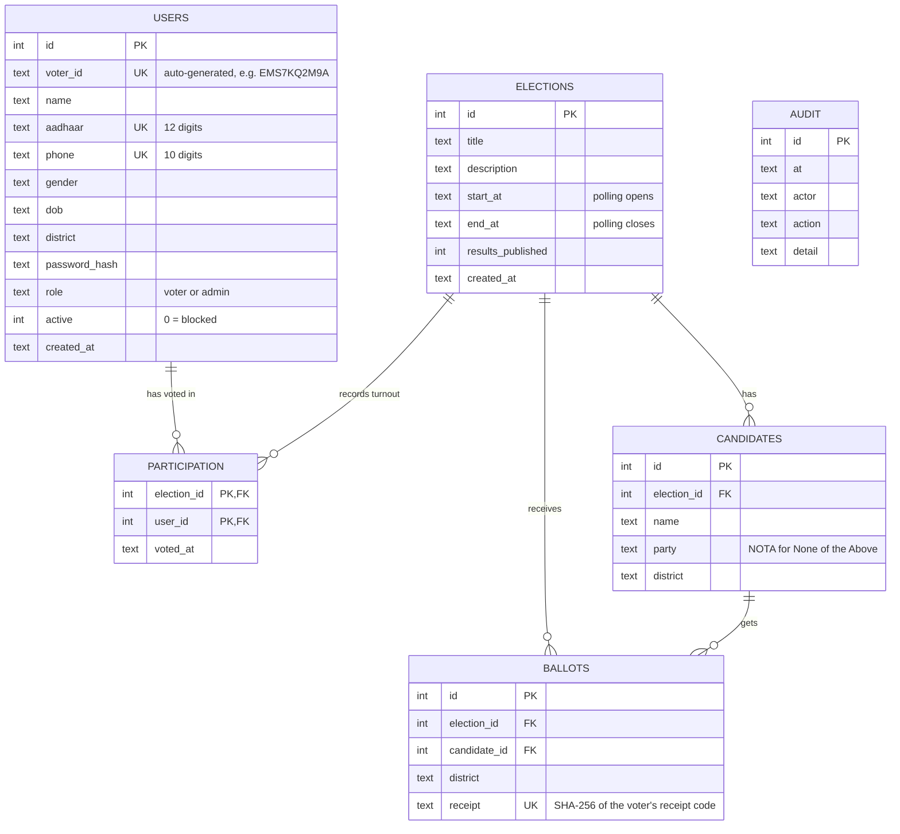
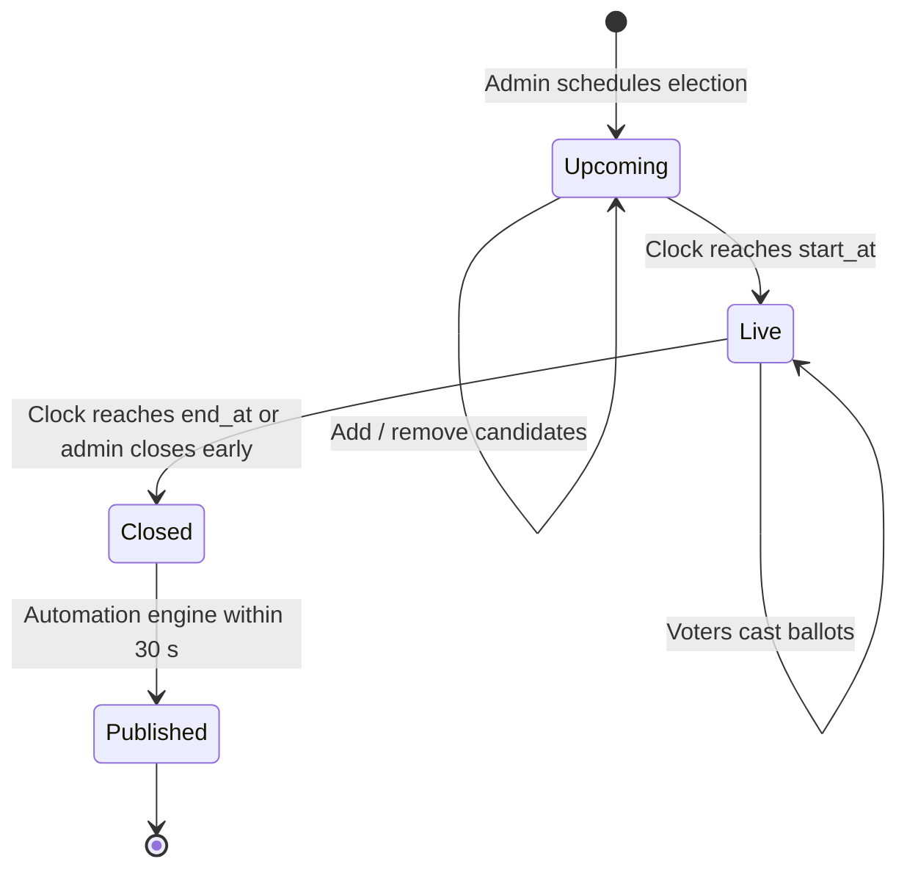
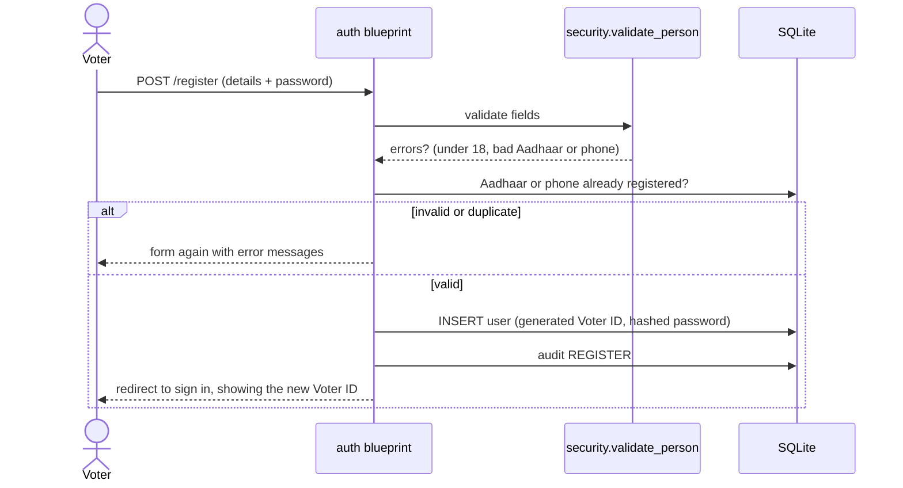
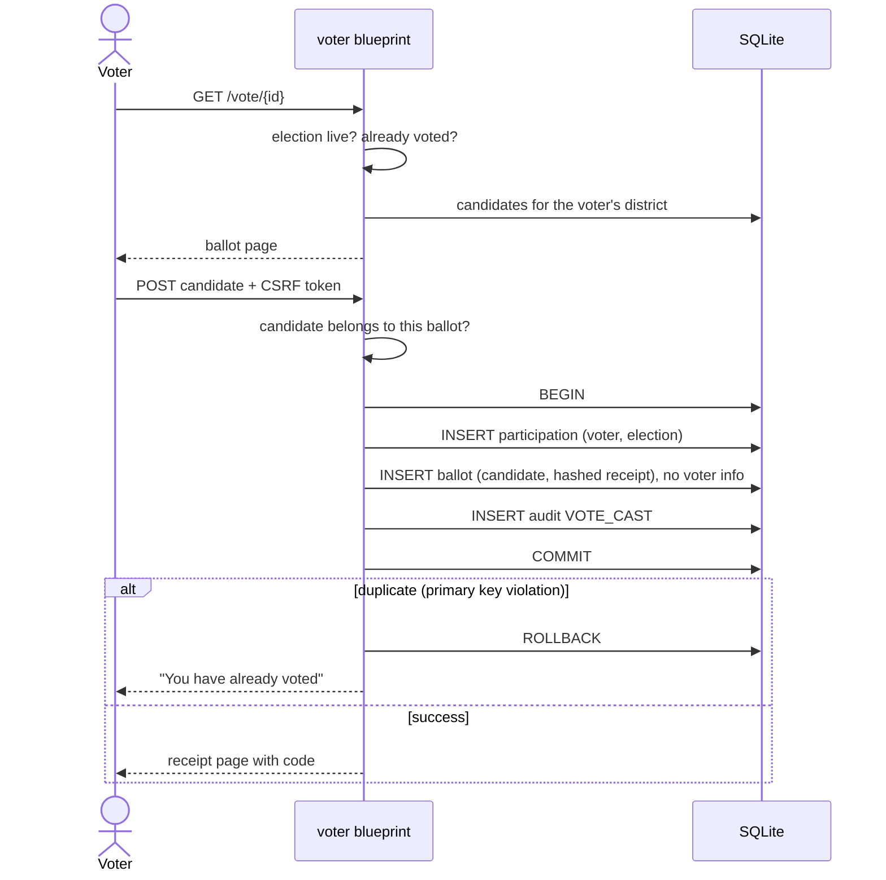

# Project Documentation

**Election Management System · Version 2.0**
Author: Priyam Mishra

- [1. Introduction](#1-introduction)
- [2. Objectives](#2-objectives)
- [3. System architecture](#3-system-architecture)
- [4. Module reference](#4-module-reference)
- [5. Database design](#5-database-design)
- [6. Election lifecycle and automation](#6-election-lifecycle-and-automation)
- [7. Key workflows](#7-key-workflows)
- [8. Result computation rules](#8-result-computation-rules)
- [9. Security design](#9-security-design)
- [10. URL reference](#10-url-reference)
- [11. Audit log events](#11-audit-log-events)
- [12. Testing](#12-testing)
- [13. Limitations and future work](#13-limitations-and-future-work)
- [14. Project history](#14-project-history)

---

## 1. Introduction

Elections run on paper and manual counting are slow, labour-intensive and prone to human error. The Election Management System (EMS) digitises the whole process, from registering voters to publishing results, and automates every step that does not need a human decision.

Version 2 is a complete redesign of my Class 12 final project (see [Project history](#14-project-history)). It turns the original single-machine Tkinter application into a multi-user web application that anyone can open in a browser.

## 2. Objectives

1. **Automate** the election lifecycle: opening, closing, counting and publishing.
2. **Protect ballot secrecy**: it must be impossible to tell from stored data who a person voted for.
3. **Guarantee one person, one vote**, enforced by the database itself.
4. **Ensure transparency** with verifiable receipts, public results and a complete audit trail.
5. **Reduce manual work and errors** through automatic Voter IDs and eligibility checks.
6. **Stay simple to deploy**: a single Python process and a single database file.

## 3. System architecture

EMS follows a classic **three-tier architecture**:

| Tier | Technology | Responsibility |
|---|---|---|
| Presentation | HTML (Jinja2 templates) and CSS | Pages for voters, admins and the public. Server-rendered, responsive, with no JavaScript framework. |
| Application | Python 3 and Flask | Routing (four blueprints), security, business rules and the automation engine. |
| Data | SQLite | Persistent storage in one file, with constraints enforcing the core rules. |

### Design decisions

- **Application factory (`create_app`).** The app is assembled in a function, so tests can build isolated instances with their own temporary database.
- **Blueprints by audience.** `public`, `auth`, `voter` and `admin` each map to one kind of user, which keeps permission rules easy to reason about.
- **Time-derived status.** An election's status is never stored. It is calculated from `start_at`, `end_at` and the current time, so it can never get out of sync.
- **Database-enforced rules.** One-vote-per-election is a primary key on `participation`, not just an `if` statement, so it holds even under concurrent requests.
- **SQLite over MySQL.** There is no server to install or configure, which suits a self-contained system. The SQL is standard, so moving to PostgreSQL or MySQL later is straightforward.

## 4. Module reference

| File | Responsibility |
|---|---|
| `run.py` | Entry point. Creates the app and starts the development server. |
| `ems/__init__.py` | `create_app()`: loads config, initialises the database, registers the CSRF check, template helpers, blueprints and error pages, and starts the scheduler. |
| `ems/config.py` | `Config` class. Every setting can be overridden by an environment variable (see [SETUP.md](SETUP.md#5-configuration)). |
| `ems/db.py` | Schema, per-request connections (`get_db`), `log()` for the audit trail, `new_voter_id()`, first-run admin creation and demo seeding. |
| `ems/automation.py` | `tally()` counts votes and decides winners, `turnout()` gives per-district participation, `build_pdf()` creates the official result sheet, `publish_due_results()` publishes closed elections, and `start_scheduler()` runs it in a background thread. |
| `ems/security.py` | `current_user()`, the `login_required(role)` decorator, `csrf_protect()` and `validate_person()`. |
| `ems/utils.py` | District list, timestamp format, `election_status()`, `age()` and date formatting. |
| `ems/routes/public.py` | Home page, results page, PDF download and receipt verification. |
| `ems/routes/auth.py` | Registration, sign in and sign out. |
| `ems/routes/voter.py` | Voter dashboard and the voting booth. |
| `ems/routes/admin.py` | Admin dashboard, election scheduling, candidate management, voter roll, CSV export and audit log. |

## 5. Database design

### How ballot secrecy works

When a vote is cast, two rows are written **in the same transaction**:

| Table | What it stores | What it does **not** store |
|---|---|---|
| `participation` | *Who* voted in *which* election, and when | The candidate chosen |
| `ballots` | *Which* candidate received a vote, and in which district | Anything about the voter |

The two rows share no key, so the database cannot link a person to their choice. The composite primary key `(election_id, user_id)` on `participation` makes a second vote by the same person fail at the database level.

### Receipts

The voter is shown a random 16-character code. Only its **SHA-256 hash** is stored with the ballot. On the Verify page, the entered code is hashed and looked up. This proves the ballot exists and was counted, but reveals nothing about who cast it or what it contains.

## 6. Election lifecycle and automation

| Status | Voters can | Admin can |
|---|---|---|
| **Upcoming** | See the opening time | Edit candidates, delete the election |
| **Live** | Vote once | Watch turnout and the provisional count, close early |
| **Closed / Published** | View results | View results, download the PDF, delete the election |

### What the automation engine does

A daemon thread starts with the app and, every `EMS_SCHEDULER_INTERVAL` seconds (default 30), runs `publish_due_results()`:

1. Find elections where `end_at` has passed and `results_published = 0`.
2. Claim each one with `UPDATE … SET results_published = 1 WHERE … AND results_published = 0`. Only one process can win this, so results are never published twice, even with several server workers.
3. Count the votes, decide winners and seats, and save `reports/election_<id>_results.pdf`.
4. Write a `RESULTS_PUBLISHED` entry to the audit log.

When an admin closes polling early, the same function runs immediately, so the results appear at once.

### Everything that is automated

| Task | Before (manual) | Now (automatic) |
|---|---|---|
| Voter ID | Officer types an ID | Unique ID generated (no look-alike characters such as 0/O and 1/I) |
| Eligibility | Officer checks documents | Age, Aadhaar format, phone format and duplicates validated on submit |
| Opening and closing polls | Officer starts and stops | Driven by the schedule |
| Counting | Manual count | Real-time SQL aggregation |
| Winners and seats | Calculated by hand | Computed per district with tie detection |
| Publishing | Announcement | Results page goes public automatically |
| Result sheet | Typed up | PDF generated and archived |
| Record-keeping | Registers | Every action logged with actor and time |

## 7. Key workflows

### Voter registration

### Casting a vote

## 8. Result computation rules

1. **Votes** are counted per candidate, per district (`ballots` grouped by `candidate_id`).
2. **District winner:** the candidate with the most votes. **NOTA** is counted and shown, but can never win.
3. **Ties:** if two or more candidates share the top count, or no votes were cast, the district is marked **Undecided**.
4. **Seats:** each district won counts as one seat for that candidate's party.
5. **Party vote share:** the sum of all votes for the party's candidates across districts.
6. **Turnout** per district = voters who voted ÷ active registered voters in that district.

Before publication, only admins can see the count (labelled *provisional*). After publication, results are public.

## 9. Security design

| Threat | Protection |
|---|---|
| Stolen passwords | Passwords stored only as salted hashes (Werkzeug PBKDF2/scrypt). |
| Cross-site request forgery | Every form carries a per-session random token, checked on every POST. |
| SQL injection | All queries use parameter placeholders (`?`), never string concatenation. |
| Cross-site scripting | Jinja2 escapes all output automatically. |
| Privilege escalation | `login_required("admin")` / `("voter")` on every protected route. Wrong role gets 403. |
| Session fixation | The session is cleared and re-issued at login. |
| Open redirect after login | `next` only accepts local paths. |
| Double voting | Database primary key, plus a check before showing the ballot. |
| Voting outside the window | Status is re-checked on every ballot request and submission. |
| Voting in another district | The candidate must belong to the voter's own district ballot. |
| Tampering after voting starts | The candidate list is locked once an election is live. Live elections cannot be deleted. |
| Accountability | Logins, failed logins, registrations, votes and every admin action are logged. |
| Blocked voters | Blocked accounts cannot sign in, and are excluded from turnout totals. |

## 10. URL reference

| Method | URL | Access | Purpose |
|---|---|---|---|
| GET | `/` | Everyone | Home page: statistics and elections |
| GET, POST | `/register` | Everyone | Voter registration |
| GET, POST | `/login` | Everyone | Sign in (voters and admin) |
| GET | `/logout` | Signed in | Sign out |
| GET, POST | `/verify` | Everyone | Verify a ballot receipt |
| GET | `/results/<id>` | Everyone once published, admin always | Results page |
| GET | `/results/<id>.pdf` | Same as above | Download the PDF result sheet |
| GET | `/dashboard` | Voter | My elections |
| GET, POST | `/vote/<id>` | Voter | Ballot |
| GET | `/admin/` | Admin | Dashboard |
| GET, POST | `/admin/elections/new` | Admin | Schedule an election |
| GET, POST | `/admin/elections/<id>` | Admin | Manage candidates, close early, delete |
| GET | `/admin/voters?q=` | Admin | Search the voter roll |
| GET | `/admin/voters/export.csv` | Admin | Export the voter roll |
| GET, POST | `/admin/voters/<id>` | Admin | Edit, block, reset password, delete |
| GET | `/admin/audit` | Admin | Audit log (latest 500 entries) |

## 11. Audit log events

| Action | Logged when |
|---|---|
| `SEED` | Demo data created on first run |
| `REGISTER` | A voter registers |
| `LOGIN` / `LOGIN_FAILED` | Any sign-in attempt |
| `VOTE_CAST` | A vote is recorded (the choice is **not** logged) |
| `ELECTION_CREATED` / `ELECTION_DELETED` / `ELECTION_CLOSED_EARLY` | Admin election actions |
| `CANDIDATE_ADDED` / `CANDIDATE_REMOVED` | Candidate list changes |
| `VOTER_UPDATED` / `VOTER_BLOCKED` / `VOTER_UNBLOCKED` / `VOTER_DELETED` / `PASSWORD_RESET` | Voter roll changes |
| `RESULTS_PUBLISHED` | Automation engine publishes an election |

## 12. Testing

`tests/test_app.py` runs the real application against a temporary database and checks:

- registration issues a Voter ID
- under-age and duplicate registrations are rejected
- a voter can vote exactly once, the ballot has no voter column, and the receipt verifies
- voting before polling opens is refused
- results stay hidden until closing, then publish automatically with a PDF
- admin pages reject anonymous users (redirect) and voters (403)
- an admin can schedule an election, with NOTA added automatically
- POST requests without a CSRF token are rejected

Run them with `pytest` (see [SETUP.md](SETUP.md#6-running-the-tests)).

## 13. Limitations and future work

| Current limitation | Planned improvement |
|---|---|
| Identity is checked by password only | OTP over SMS or email, and biometric or face verification at booths |
| Districts are fixed in `utils.py` | Constituency management in the admin panel |
| English only | Hindi and Marathi interface |
| SQLite suits small and medium deployments | PostgreSQL support for state-scale elections |
| Manual deployment | Docker image and one-click cloud deployment |
| One admin account | Multiple officers with different permission levels |

## 14. Project history

**Version 1 (Class 12 final project).** My first professional project, built over eight months of Class 12 using Python, Tkinter and MySQL: everything I knew at the time. It handled voter and admin registration, login by Voter ID, voting for one of four parties, voter record management and a PDF of the results. Both the internal and external examiners were highly satisfied with it, and I secured 100/100 in my final examinations. The code is preserved in [`legacy/`](../legacy/).

**Version 2 (this redesign).** The same idea rebuilt from the ground up: a web interface, automation of the full lifecycle, a secret-ballot data model, multiple elections and districts, verifiable receipts, an audit trail, automated tests and full documentation.
